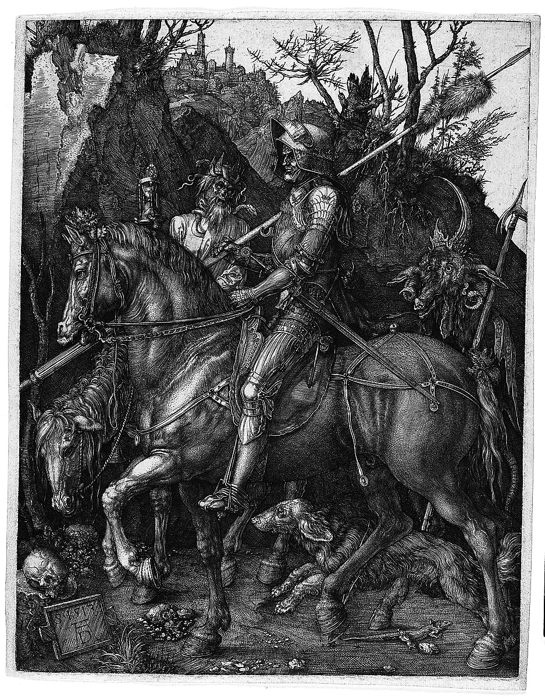

# 𝔐𝔞𝔠𝔥𝔦𝔫𝔢 𝔏𝔢𝔞𝔯𝔫𝔦𝔫𝔤 𝔈𝔫𝔤𝔦𝔫𝔢𝔢𝔯

*«𝔖𝔠𝔦𝔢𝔫𝔱𝔦𝔞 𝔢𝔰𝔱 𝔭𝔬𝔱𝔢𝔫𝔱𝔦𝔞 𝔢𝔱 𝔲𝔫𝔟𝔯𝔞»*

---

<!-- Гравюра Дюрера -->

  

---

## 𝔒𝔲𝔱 𝔬𝔣 𝔱𝔥𝔢 𝔖𝔥𝔞𝔡𝔬𝔴𝔰 (𝔖𝔲𝔪𝔪𝔞𝔯𝔶)

* 🌌 **Фокус:** Создание автономных интеллектуальных агентов и локальных систем на базе **LLM**.
* ⚙️ **В разработке:** [SwarmIDE](https://github.com) — высокопроизводительный, нативный С++ аналог n8n для оркестрации и автоматизации рабочих процессов ИИ.
* 💀 **Эстетика:** Минималистичный код, низкоуровневая магия графики и строгий архитектурный порядок.

---

## 𝔗𝔥𝔢 𝔄𝔯𝔰 𝔊𝔬𝔢𝔱𝔦𝔞 𝔬𝔣 𝔗𝔢𝔠𝔥𝔫𝔬𝔩𝔬𝔤𝔶 (𝔖𝔱𝔞𝔠𝔨)

* ⚔️ **Languages:** `C++` | `C` | `C#` | `Python` | `SQL`
* 🕸️ **Backend & Graphics:** `Docker` | `PostgreSQL` | `FastAPI` | `GLFW` | `GLM` | `OpenGL`
* 🧠 **Artificial Intelligence:** `Ollama` (LLM Agents)
* 𝔗 **Tools:** `VS Code` | `Git`

---

## 𝔖𝔲𝔪𝔪𝔬𝔫 𝔐𝔢 (𝔖𝔬𝔠𝔦𝔞𝔩𝔰)

* 📨 **Telegram:** [@M_4_R_G_I_N_A_L](https://t.me)
---

<!-- Стабильный инфо-виджет в самом низу профиля -->

  

